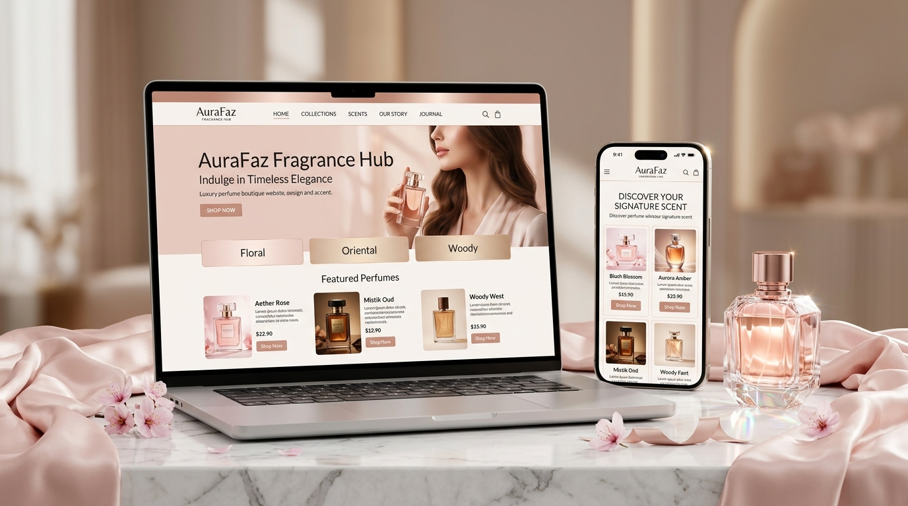

# Perfume E-commerce Website 💐

Welcome to **AuraFaz Fragrance Hub** – A beautifully designed perfume boutique and booking shop website.  
This project is built using **HTML5, CSS3, and JavaScript** to showcase luxury fragrances with an elegant, responsive UI/UX.

---

## 🖼️ Live Preview

🔗 **[Experience the Live Website Here](https://fasee9831.github.io/Perfume-ecommerce-website/)**

---

## 🌸 Key Features

- **Luxury Preloader:** Animated crystal perfume bottle with floating mist particles and dynamic loading bar.
- **Dynamic Tagline:** Interactive typewriter animation cycling signature fragrance notes.
- **Mobile-First Responsive Layout:** Glassmorphic mobile navbar with hamburger menu, 2-column mobile catalog grid, and touch-friendly controls.
- **Fragrance Finder & Scent Quiz:** Interactive quiz recommending personalized perfume profiles.
- **Brand Story & Interactive Heritage Timeline:** Milestone journey from 2018 to present.
- **Booking & Order System:** Intuitive sample booking and checkout flows with client-side validation.
- **User Authentication:** Login and signup cards with pre-filled test credentials for seamless testing.
